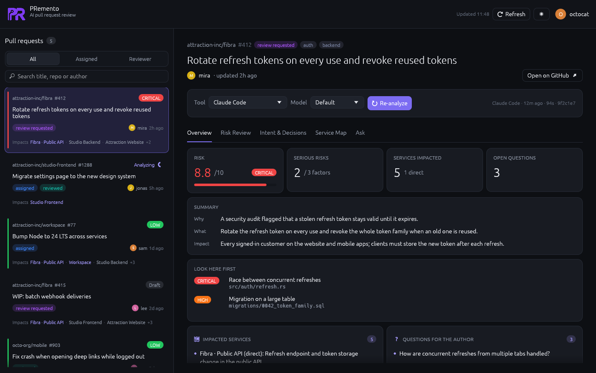
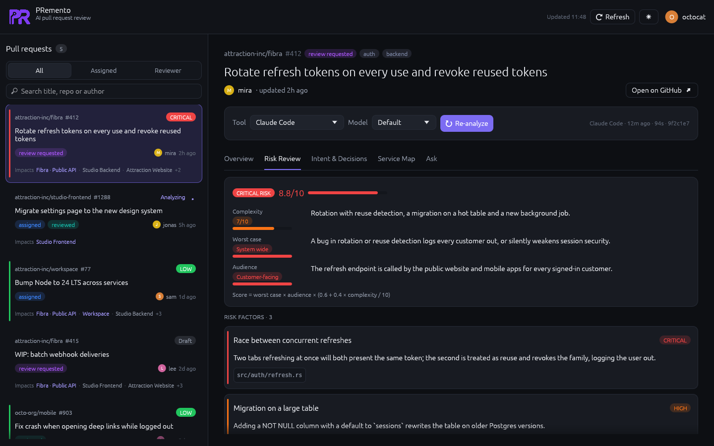
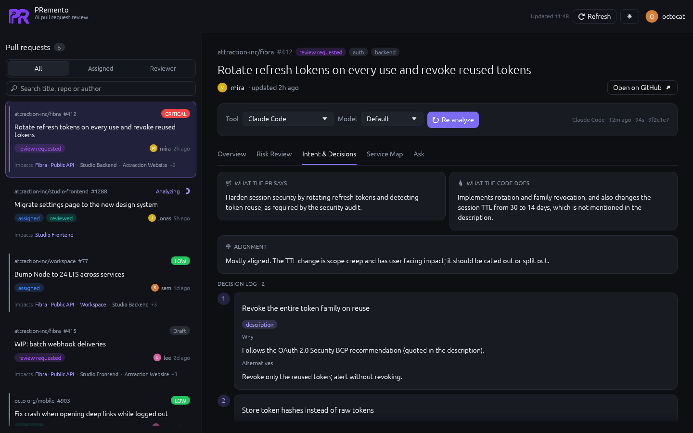
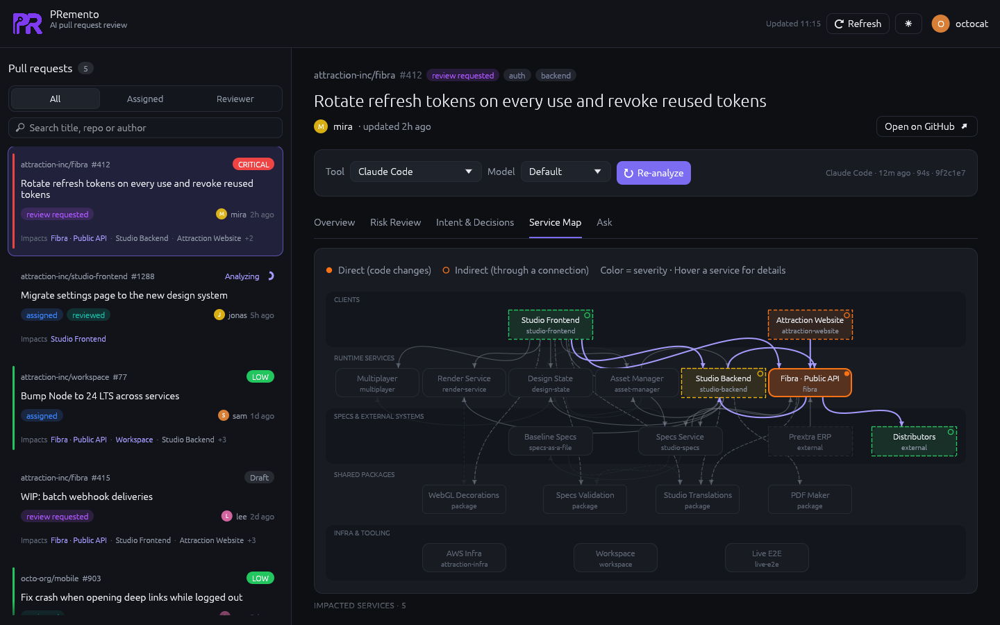
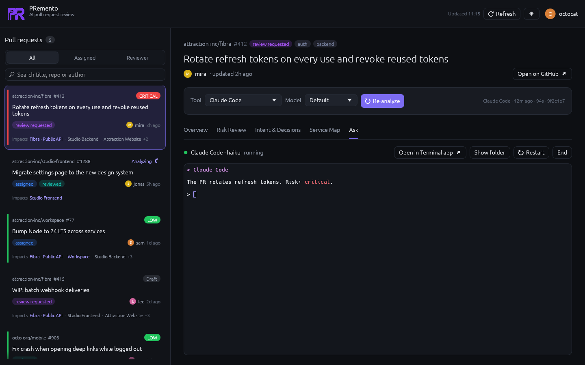

<div align="center">


# PRemento

**Your pull request review copilot.**

A native Rust desktop app that gathers the GitHub PRs waiting on you and reviews them with the LLM CLI you already use:
Claude Code, Codex, Gemini CLI, Ollama, or any other command.


<picture>
  <source media="(prefers-color-scheme: dark)" srcset="docs/screenshots/overview-dark.png">
  <source media="(prefers-color-scheme: light)" srcset="docs/screenshots/overview-light.png">
  
</picture>

</div>

---

## Contents

- [Why PRemento](#why-premento)
- [Features](#features)
- [Quick start](#quick-start)
- [Usage](#usage)
- [Configuration](#configuration)
- [Risk score](#risk-score)
- [Service map](#service-map)
- [Privacy: what is sent to the LLM](#privacy-what-is-sent-to-the-llm)
- [Development](#development)

## Why PRemento

- **One inbox for reviews.** Lists every open PR where you are **assignee** or **reviewer** (review requested, or already reviewed), with a risk badge on each.
- **Bring your own LLM.** No API keys to set up. PRemento runs the CLI already on your machine.
- **Know where to look first.** A risk score that you can explain, the risky spots with file paths, and the questions to ask the author.
- **Ask follow-up questions.** A Claude Code or Codex session opens next to the PR, with the diff and the review already in its folder.
- **No token setup.** Every GitHub call goes through [`gh`](https://cli.github.com/).

## Features

Each analysis opens on an **Overview** tab: why the PR exists, what it decides and what it affects, one line each, plus the headline numbers from the tabs below.

| Tab | What you get |
|---|---|
| **Risk Review** | A [risk score](#risk-score) computed from complexity, worst case and audience, and up to three risk factors with severity and files |
| **Intent & Decisions** | What the PR says it does vs. what the code actually does, whether they match, the design decisions taken (why, alternatives, source) and questions to ask the author |
| **Service Map** (attraction-inc PRs) | The attraction-inc architecture as a map, with each impacted service highlighted as **direct** (its code or config changes) or **indirect** (affected through a connection), colored by severity |
| **Impact Analysis** (other repos) | Affected components, breaking changes, downstream effects, data/migrations, security, performance, test coverage and suggested tests |
| **Ask** | A terminal built into the tab, running Claude Code or Codex in a folder that holds the PR and its review |

<table>
  <tr>
    <td width="50%"><b>Risk Review</b><br></td>
    <td width="50%"><b>Intent & Decisions</b><br></td>
  </tr>
  <tr>
    <td width="50%"><b>Service Map</b><br></td>
    <td width="50%"><b>Ask</b><br></td>
  </tr>
</table>

<sub>Screenshots are rendered from demo data. See [Development](#development).</sub>

## Quick start

**Requirements**

- Rust (edition 2024)
- [`gh`](https://cli.github.com/), logged in with `gh auth login`
- At least one LLM CLI on your `PATH` (`claude`, `codex`, `gemini`, `ollama`, …)

**Run**

```bash
git clone https://github.com/LoukaG/premento.git && cd premento
cargo run --release
```

## Usage

### Desktop app

1. **⟳ Refresh** loads your PRs. Filter them with *All / Assigned / Reviewer* or the search box.
2. Select a PR, choose a **Tool** and a **Model** (e.g. Claude Code with `fable`, `opus`, `sonnet` or `haiku`; **Other…** to type any model name).
3. Click **🔍 Analyze**. Analyses run in the background, so you can start several at once. **Cancel** stops one.

Results are cached on disk and appear again on the next launch.

### Ask tab

The **Ask** tab runs Claude Code or Codex in a folder holding the PR (description, commits, discussion and diff, fetched when you start) and its review. It uses the tool and model picked above the tabs.

- Click the terminal to type. Drag to select, **Cmd+C** to copy, **Cmd+V** to paste, and the mouse wheel scrolls back.
- Sessions keep running when you switch tabs or PRs. **End** stops one.
- **Open in Terminal app** runs the same session in a separate terminal instead.
- The folder is kept per PR (`~/Library/Caches/memento/ask/<pr>`), so `claude --continue` or `codex resume --last` there picks up the last conversation.
- Codex runs in a read-only sandbox. The first time, Claude Code asks whether to trust the folder.

### Headless mode

Prints the analysis as JSON, useful for scripts and CI:

```bash
cargo run --release -- analyze owner/repo#123 "Claude Code" haiku   # model is optional
```

## Configuration

On first run, a config file is written to:

| OS | Path |
|---|---|
| macOS | `~/Library/Application Support/memento/config.toml` |
| Linux | `~/.config/memento/config.toml` |

> PRemento keeps the original `memento` settings and cache directories, so existing configs and reviews stay available.

```toml
default_provider = "Claude Code"
max_diff_chars = 150000   # the diff is truncated beyond this
timeout_secs = 900
search_limit = 100

[[providers]]
name = "Claude Code"
command = "claude"
args = ["-p", "--output-format", "text"]
stdin = true
model_args = ["--model", "{model}"]          # how the chosen model is passed
models = ["fable", "opus", "sonnet", "haiku"] # offered in the Model picker

[[providers]]
name = "Codex"
command = "codex"
args = ["exec", "{model_args}", "--skip-git-repo-check", "--sandbox", "read-only", "--ephemeral", "-o", "{output_file}", "-"]
stdin = true
model_args = ["-m", "{model}"]
```

<details>
<summary><b>Providers and placeholders</b></summary>

The prompt is sent to the provider on stdin. Three placeholders can appear in `args`:

| Placeholder | Meaning |
|---|---|
| `{prompt_file}` | A file containing the prompt |
| `{output_file}` | When present, the answer is read from this file instead of stdout |
| `{model_args}` | Where the model args go. Without it, they are put first |

Add a `[[providers]]` block for any other tool.

</details>

<details>
<summary><b>Models</b></summary>

A provider with `model_args` gets a Model picker: **Default** (the tool's own default, or `default_model` if set), each entry of `models`, or **Other…** to type any model name. When Default is picked and there is no `default_model`, no model args are passed.

The model used is shown with each analysis (e.g. `Claude Code · haiku`). Config files written by earlier versions get these options automatically, as long as the provider's `args` were not edited.

</details>

<details>
<summary><b>Ask tab and terminal</b></summary>

`chat_args` are the args for an interactive session, with `{prompt}` (the opening message) and `{model_args}`. Claude Code and Codex have built-in defaults. Set `chat_args = []` to hide a tool from the Ask tab.

The external terminal is Terminal.app on macOS and `x-terminal-emulator` on Linux. To use another one:

```toml
terminal = ["open", "-a", "iTerm", "{script}"]
```

</details>

## Risk score

The LLM rates three dimensions, and PRemento computes the score from them (`RiskReview::compute` in [`src/features/analysis/scoring.rs`](src/features/analysis/scoring.rs)).

| Dimension | Values |
|---|---|
| **Complexity** | 0–10: how hard the change is to get right |
| **Worst case** | `cosmetic` (1) · `feature` (3): one feature stops working, e.g. a preview renders wrong · `core_flow` (7): checkout, payments, orders, data sync · `system_wide` (10): login/auth, whole app crashes, data loss, security |
| **Audience** | `customer` (×1.0) · `partner` (×0.85) · `internal` admin/staff (×0.6) · `developer` CI/tooling (×0.3) |

```
score = worst_case × audience × (0.6 + 0.4 × complexity / 10)
```

| Level | Score |
|---|---|
| 🟢 low | < 3.5 |
| 🟡 medium | 3.5 – 6 |
| 🟠 high | 6 – 8 |
| 🔴 critical | ≥ 8 |

The worst case sets the ceiling and complexity only moves the score within it. A change that can only break one feature (max 3.0) is always low, however complex. A one-line change to customer login is 6.8 (high), and a moderately complex one is critical.

Cached analyses are re-scored on load. Ones from before the three dimensions existed keep the score the LLM gave them.

## Service map

The map of attraction-inc services and their main connections is defined in [`src/features/service_map/graph.rs`](src/features/service_map/graph.rs), based on `attraction-inc/workspace` (`ARCHITECTURE.md`, `docker-compose.yml`).

- When the PR is in attraction-inc, the map is sent to the LLM, which returns `service_impact`.
- The PR's own repo is always shown as directly impacted.
- PRs without an AI result use an estimate: the repo's service plus the services that call it.
- The full map is shown when no PR is selected, and every attraction-inc PR in the list shows the services it impacts.

Update `NODES` / `EDGES` in `graph.rs` when the architecture changes.

## Privacy: what is sent to the LLM

The PR title, description, labels, branches, commits, changed files, the conversation (comments, reviews and inline review comments) and the diff. The LLM runs in a temporary empty directory.

## Development

### Layout

Code is grouped by feature. Each feature folder holds its data, logic, state and views. Shared code lives in `core/` and `ui/`.

```
src/
  main.rs                  entry point
  cli.rs                   headless `analyze` command
  app/                     app shell: holds each feature's state, routes background events, lays out the panels
    mod.rs  messages.rs  top_bar.rs  details.rs (tabs)
    snapshots.rs           offscreen UI snapshots + glyph check (tests), with demo_analysis.json
  core/                    config.rs (settings), paths.rs (config/cache dirs), format.rs (relative times)
  ui/                      design system: theme.rs (palette, style), widgets.rs (pills, cards, tabs),
                           blocks.rs (stat tiles, list cards, callouts, banners), icon.rs
  features/
    pull_requests/         model.rs, github.rs (gh CLI: PR search + context), state.rs (list, filter,
                           selection), list_view.rs (sidebar), header.rs
    analysis/              model.rs, scoring.rs (risk score), prompt.rs (prompt, schema, parsing),
                           cache.rs, state.rs (running jobs + results), views/ (action bar + one file per tab)
    ask/                   session.rs (prepares the PR folder + command), state.rs, view.rs (Ask tab)
    providers/             config.rs (provider settings + defaults), runner.rs (runs a CLI with
                           timeout/cancel), picker.rs (tool + model pickers)
    service_map/           graph.rs (services + connections), impact.rs (impact + prompt), view.rs (map)
    terminal/              terminal emulator widget (alacritty_terminal + PTY): mod.rs, input.rs, paint.rs, palette.rs
```

### UI snapshots

The UI can be rendered offscreen with demo data (dark + light, every tab):

```bash
MEMENTO_SNAPSHOT_DIR=/tmp/memento-shots cargo test render_screens
```

The README screenshots in [`docs/screenshots/`](docs/screenshots) come from this command:

| README file | Snapshot |
|---|---|
| `overview-dark.png` / `overview-light.png` | `dark-Overview.png` / `light-Overview.png` |
| `risk-review.png` | `dark-Risk_Review.png` |
| `intent.png` | `dark-Intent_&_Decisions.png` |
| `service-map.png` | `dark-Service_Map.png` |
| `ask.png` | `dark-ask-running.png` |

A test (`all_ui_glyphs_exist`) also fails if the UI uses a character the bundled fonts cannot draw.
